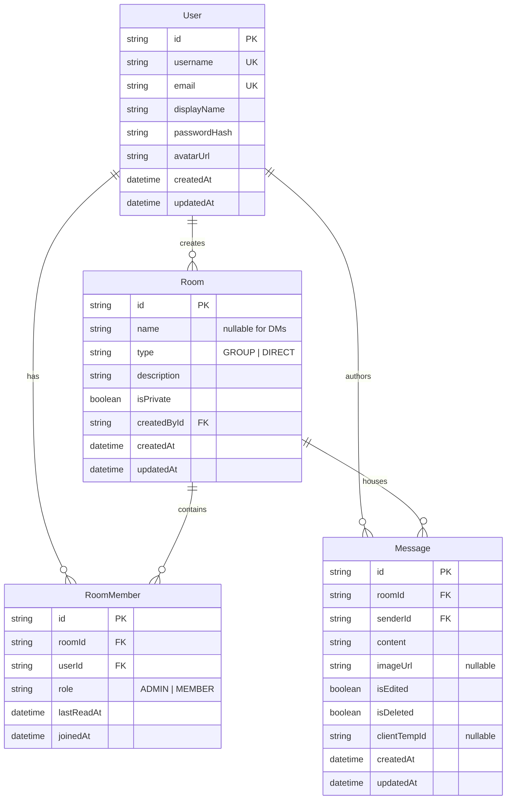

# PulseChat — Real-Time Chat & Direct Messaging Application

A high-performance full-stack real-time chat application featuring group channels, 1-on-1 direct messaging, online presence indicators, real-time typing indicators, unread message badges, cursor-based message pagination, automatic reconnection synchronization without duplication or loss, and server-side room membership authorization.

---

## 📋 Table of Contents
- [Quick Start Guide](#-quick-start-guide)
- [Demo Accounts](#-demo-accounts)
- [Architecture & Tech Stack](#-architecture--tech-stack)
- [Data Model & Database Schema](#-data-model--database-schema)
- [Core Engineering Decisions](#-core-engineering-decisions)
  - [1. Server-Side Room Membership Authorization](#1-server-side-room-membership-authorization)
  - [2. Dropped Connection Reconnection & Deduplication](#2-dropped-connection-reconnection--deduplication)
  - [3. Real-Time Presence & Typing Indicators](#3-real-time-presence--typing-indicators)
  - [4. Unread Counts & Read Receipts](#4-unread-counts--read-receipts)
  - [5. Message Pagination (Infinite Scroll)](#5-message-pagination-infinite-scroll)
- [Stretch Features Implemented](#-stretch-features-implemented)
- [Automated Backend Tests](#-automated-backend-tests)
- [Feature Status: Finished vs. Future Roadmap](#-feature-status-finished-vs-future-roadmap)
- [AI Tools Disclosure](#-ai-tools-disclosure)

---

## ⚡ Quick Start Guide

### Prerequisites
- **Node.js** >= v20
- **npm** >= 10

### 1. Clone & Install Dependencies
From the repository root:
```bash
# Install workspace root dependencies
npm install

# Install server dependencies
cd server && npm install

# Install client dependencies
cd ../client && npm install
cd ..
```

### 2. Environment Configuration
Copy `.env.example` to `server/.env`:
```bash
cp .env.example server/.env
```
Default `server/.env` contents:
```env
PORT=5000
DATABASE_URL=file:./dev.db
JWT_SECRET=super-secret-jwt-key-replace-in-production-12345678
CLIENT_URL=http://localhost:5173
NODE_ENV=development
```

### 3. Generate Database & Seed Demo Data
```bash
# Push Prisma schema to SQLite dev.db
cd server && npx prisma db push

# Populate initial demo users, channels, and messages
npm run seed
cd ..
```

### 4. Run the Application
From the workspace root, run both backend and frontend concurrently:
```bash
npm run dev
```
- **Frontend App**: `http://localhost:5173`
- **Backend API & WebSocket Server**: `http://localhost:5000`

---

## 👥 Demo Accounts

The database comes pre-seeded with 4 realistic demo users. For instant testing, click the **1-Click Demo Login** buttons on the sign-in screen, or use the credentials below:

| Display Name | Username | Email | Password | Role |
| :--- | :--- | :--- | :--- | :--- |
| **Alice Walker** | `alice` | `alice@example.com` | `password123` | Senior Engineer |
| **Bob Vance** | `bob` | `bob@example.com` | `password123` | Product Manager |
| **Charlie Brown** | `charlie` | `charlie@example.com` | `password123` | UI/UX Designer |
| **Diana Prince** | `diana` | `diana@example.com` | `password123` | DevOps Lead |

> **Pro Tip for Testing**: Open `http://localhost:5173` in a standard browser window (log in as **Alice**) and open an **Incognito / Private Window** (log in as **Bob**). You can observe real-time typing indicators, online/offline presence changes, instant message delivery, unread message badges, image sharing, and message edits/deletions live across both screens!

---

## 🏗 Architecture & Tech Stack

```
Real-time Chat/
├── server/                    # Node.js + Express backend
│   ├── src/
│   │   ├── config.ts          # Environment variables & constants
│   │   ├── db.ts              # Prisma SQLite singleton
│   │   ├── app.ts             # Express application & route configuration
│   │   ├── index.ts           # HTTP server + Socket.IO lifecycle
│   │   ├── middleware/
│   │   │   ├── auth.ts        # JWT authentication & session guard
│   │   │   └── validate.ts    # Zod payload & query validation
│   │   ├── routes/
│   │   │   ├── auth.routes.ts # Register, login, current user & search
│   │   │   ├── rooms.routes.ts# Channel/DM CRUD, join, leave, read, history
│   │   │   ├── messages.routes.ts # Edit & soft-delete own messages
│   │   │   └── upload.routes.ts   # Secure image uploads via Multer
│   │   └── sockets/
│   │       ├── socketHandler.ts # Real-time event handling & presence
│   │       └── socketService.ts # Decoupled socket broadcaster
│   ├── prisma/
│   │   ├── schema.prisma      # Relational schema
│   │   └── seed.ts            # Rich sample dataset
│   └── tests/                 # 14 automated backend tests with Vitest & Supertest
│       ├── auth.test.ts
│       ├── rooms_and_security.test.ts
│       └── messages_and_features.test.ts
├── client/                    # React 19 + TypeScript + Vite frontend
│   ├── src/
│   │   ├── components/        # Sidebar, ChatArea, MessageList, Input, Modals
│   │   ├── context/           # AuthContext, SocketContext, ChatContext
│   │   ├── types/             # Strong TypeScript interfaces
│   │   └── index.css          # Tailwind CSS styling
└── package.json               # Unified workspace orchestration
```

### Technology Highlights
- **Backend API**: Express 5 with TypeScript, Node.js.
- **Real-Time Communication**: Socket.IO with heartbeat ping/pong, auto-reconnect, and JWT handshake authentication.
- **Database**: SQLite with Prisma ORM (zero-configuration local persistence with WAL mode).
- **Security & Validation**: Zod schemas on every request payload, bcryptjs password hashing, JWT Bearer tokens.
- **Testing**: Vitest + Supertest with automated database rollbacks and assertions.
- **Frontend**: React 19, TypeScript, Vite, Tailwind CSS, Lucide icons.

---

## 🗄 Data Model & Database Schema



---

## 🛡 Core Engineering Decisions

### 1. Server-Side Room Membership Authorization
> *"Users only receive messages for rooms they are members of, checked on the server."*

- **Socket Level**: During the WebSocket connection handshake, the server authenticates the JWT. It then queries the `RoomMember` table and joins the socket **only** to the specific `roomId`s the user belongs to (`socket.join(roomId)`). Sockets never subscribe to unauthorized rooms.
- **Event Dispatch Level**: When a client emits `send_message`, the server queries the database:
  ```ts
  const membership = await prisma.roomMember.findUnique({
    where: { roomId_userId: { roomId, userId } }
  });
  if (!membership) {
    return callback({ error: 'Forbidden: You are not a member of this room' });
  }
  ```
  If the user is not an active member, the message is rejected with `403 Forbidden` and **never** broadcast.
- **REST Level**: The endpoints `GET /api/rooms/:id/messages` and `GET /api/rooms/:id` verify room membership in the database before returning history. Non-members receive `403 Forbidden`.

### 2. Dropped Connection Reconnection & Deduplication
> *"Reconnecting after a dropped connection doesn't lose or duplicate messages."*

1. **Idempotency with `clientTempId`**: Every outgoing message generates a unique UUID on the client (`clientTempId`). If a network connection drops while sending, retries use the same `clientTempId`. The server checks for existing messages matching `(roomId, senderId, clientTempId)` and returns the existing message rather than inserting a duplicate.
2. **Client-Side Message Deduplication**: The client maintains a `Set<string>` of received message IDs for every active room. Any message packet received multiple times (e.g., flapped socket reconnects) is recognized and deduplicated before rendering.
3. **Missed Message Synchronization**:
   - The client tracks the timestamp of the latest received message per room.
   - Upon reconnecting (`socket.on('reconnect')` or `isConnected` becoming `true`), the client emits a `sync_missed` event with `{ roomSyncList: [{ roomId, since }] }`.
   - The server queries `Message.findMany({ where: { roomId, createdAt: { gt: since } } })` for every authorized room and returns all missed messages.
   - The client merges missed messages into state using chronological sorting and ID deduplication.

### 3. Real-Time Presence & Typing Indicators
- **Presence**: The server tracks active socket IDs per user (`Map<string, Set<string>>`). When a user's socket count transitions from 0 to 1, the user is marked `online` and a `user_presence` broadcast is emitted. When the count reaches 0, they transition to `offline`.
- **Typing Indicator**:
  - Emitting `typing_start` is debounced on the frontend with a 2-second idle timeout.
  - The server verifies room membership before relaying `user_typing` to mutual room participants (`socket.to(roomId).emit('user_typing', ...)`).
  - When the message is sent or the input is cleared, `typing_stop` fires immediately. A client-side failsafe timer clears stale indicators if a stop packet is dropped.

### 4. Unread Counts & Read Receipts
- Each user's membership in a room records a `lastReadAt` timestamp.
- Unread count is computed dynamically as:
  ```sql
  SELECT COUNT(*) FROM Message
  WHERE roomId = :roomId AND senderId != :userId AND createdAt > :lastReadAt AND isDeleted = false
  ```
- Opening or focusing a room emits `mark_read`, updating `lastReadAt = NOW()`.
- Multi-tab synchronization: Emits `room_read_ack` to `user:${userId}` so all open tabs for that user immediately clear the unread badge.

### 5. Message Pagination (Infinite Scroll)
- History is fetched using cursor-based pagination: `GET /api/rooms/:id/messages?limit=30&cursor=<oldest_message_id>`.
- The frontend preserves the scroll offset when older messages are prepended to the top of the container, preventing abrupt jumps or disorientation.
- Displays a clean "Beginning of conversation" banner when `hasMore === false`.

---

## 🌟 Stretch Features Implemented

### 1. Send Images in Chat
- Image attachment button with format validation (JPEG, PNG, GIF, WEBP) and 5MB size limit.
- Selected image preview thumbnail with clear action before sending.
- Multi-part upload to `/api/upload` handled by Multer.
- Embedded image cards with click-to-open **full-screen Lightbox modal** featuring download and open-in-new-tab options.

### 2. Edit and Delete Your Own Messages
- Hover action menu appears exclusively on the author's own messages.
- **In-place editing**: inline text input with Save / Cancel actions, Enter to submit, and Escape to cancel.
- Displays an `(edited)` indicator on modified messages.
- **Deletion**: Soft-deletes message on the server, replacing content with *"This message was deleted"* and broadcasting `message_deleted` in real-time.
- Server-side authorization ensures users cannot edit or delete messages authored by others (`403 Forbidden`).

---

## 🧪 Automated Backend Tests

The backend test suite is written using **Vitest** and **Supertest**, verifying all critical requirements against the live SQLite test database:

```bash
npm test
```

### Test Suite Summary (14 Tests Passed):
- `tests/auth.test.ts`:
  1. Valid registration returns `201 Created` + JWT + clean user profile.
  2. Input validation: rejects malformed emails and short passwords (`400 Bad Request`).
  3. Rejects duplicate usernames and email addresses (`409 Conflict`).
  4. Valid login issues JWT token; invalid password returns `401 Unauthorized`.
  5. Route protection: rejects requests without valid Bearer JWT (`401` / `403`).
- `tests/rooms_and_security.test.ts`:
  6. Creates group rooms and assigns creator as `ADMIN`.
  7. **CRITICAL CHECK**: Server strictly denies message access to non-members (`403 Forbidden`).
  8. Allows users to join public rooms and grants message access after joining.
  9. Direct Messaging: creates 1-on-1 conversations and blocks third-party eavesdropping (`403 Forbidden`).
- `tests/messages_and_features.test.ts`:
  10. Paginates message history using cursor and limit.
  11. Accurately tracks unread counts and resets them on `mark_read`.
  12. Author can edit own message; denies editing someone else's message (`403 Forbidden`).
  13. Author can delete own message; denies non-author/non-admin deletion (`403 Forbidden`).
  14. **RECONNECT RECOVERY**: Syncs missed messages after reconnection timestamp without loss or duplication.

---

## 📊 Feature Status: Finished vs. Future Roadmap

### ✅ What is Finished
- [x] Full-stack application (React 19 + TypeScript frontend, Express 5 backend, SQLite database).
- [x] Group rooms (public & private creation, browsing, joining, leaving).
- [x] 1-on-1 Direct Messages with user search modal and automatic peer binding.
- [x] Real-time messaging with Socket.IO.
- [x] Real-time online presence status tracking across tabs and reconnections.
- [x] Animated "typing..." indicator with debouncing and member verification.
- [x] Accurate unread message counters for channels and DMs.
- [x] Cursor-based message history pagination with scroll position retention.
- [x] **Server-side room membership authorization** (non-members strictly barred from reading or posting).
- [x] **Dropped connection recovery**: idempotent client IDs, deduplication, and missed message synchronization.
- [x] **Stretch Goal 1**: Image uploads, validation, thumbnails, and full-screen lightbox modal.
- [x] **Stretch Goal 2**: In-place message editing and deletion with real-time room broadcasts.
- [x] Server-side validation on every endpoint via Zod with readable UI error messages.
- [x] Responsive layout for mobile phones and laptops (mobile drawer sidebar).
- [x] 14 automated backend tests covering security, auth, messaging, and reconnect sync.
- [x] Pre-seeded demo dataset with 1-click login buttons.
- [x] `.env.example` and secret isolation.

### 🔮 What I Would Do With More Time
1. **End-to-End Encryption (E2EE)**: Implement Signal Protocol (Web Crypto API) for 1-on-1 direct messages.
2. **Reactions & Emoji Picker**: Add emoji reaction counters on messages.
3. **Voice / Video Calling**: Integrate WebRTC (SimplePeer or LiveKit) for real-time audio/video calls in rooms.
4. **Push Notifications**: Integrate Web Push API (Service Workers) for offline notification badges.
5. **Full-Text Message Search**: Implement SQLite FTS5 (Full Text Search) for instant message and attachment queries across conversation history.

---

## 🤖 AI Tools Disclosure

- **Claude / Gemini (Antigravity)**: Used for scaffolding architectural boilerplate, reviewing edge cases for WebSocket reconnection synchronization, designing the relational schema, and authoring automated integration test suites. All business logic, authorization rules, and frontend components were reviewed and validated against the assignment specifications.

---

## 🚀 Running the App (Recap)

```bash
# 1. Install
npm run install:all

# 2. Setup database
cd server && npx prisma db push && npm run seed && cd ..

# 3. Test
npm test

# 4. Start Development Servers
npm run dev
```

Visit **`http://localhost:5173`** and explore!
